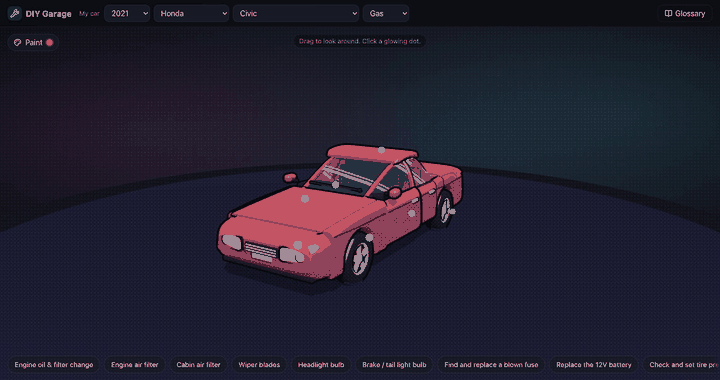
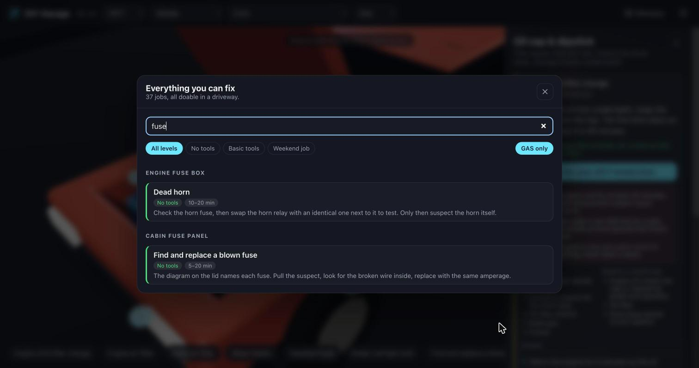

# DIY Garage

**Live site: https://sea-chels.github.io/diy-garage/**

Click a part of a stylized 3D car, see the repairs you can safely do yourself, and watch how-to videos for your exact year, make and model.

Purely client-side: Vite + TypeScript + Three.js, no backend, no database.



| Pick a part, get the job | Search everything you can fix |
|---|---|
|  |  |


## Run

```sh
pnpm install
pnpm dev        # http://localhost:5173
pnpm build      # outputs dist/
```

## Data sources

| What | Where | Cost |
|---|---|---|
| Models for a year + make | NHTSA vPIC API, keyless, CORS-enabled | Free |
| Repair catalog, steps, tools, cautions | `src/data/repairs.ts`, hand-written | Free |
| Videos | YouTube Data API v3, optional | Free, about 100 searches/day |

Without a YouTube key the video modal links out to a YouTube search for the selected car. With a key it lists and plays videos in-page through the `youtube-nocookie.com` embed. Results are cached in localStorage for a week to stretch the quota.

YouTube embeds are not guaranteed ad-free. The privacy-enhanced embed drops tracking cookies until play, but the creator decides whether ads run.

## Project layout

```
src/
  data/parts.ts      clickable regions (PartId) and which lid hides them
  data/repairs.ts    the repair catalog; add jobs here
  data/makes.ts      make list, year range, powertrain guess
  api/vpic.ts        NHTSA model lookup
  api/youtube.ts     search + localStorage cache, API key handling
  scene/car.ts       the stylized car (swap this to iterate on the model)
  scene/scene.ts     renderer, lights, picking, camera fly-to
  scene/tween.ts     tiny tween runner
  ui/*               vehicle picker, side panel, video modal, glossary, settings
```

### Iterating on the car

`scene/car.ts` returns a `CarRig`. Anything that satisfies that interface works, including a GLB loaded with `GLTFLoader`. The rig must provide:

- a hotspot mesh list for every `PartId` in `data/parts.ts`
- a camera view per part plus an overview
- `setLid('hood' | 'trunk' | 'door', open)` for the opening animations

### Adding a repair

Add an entry to `REPAIRS` in `src/data/repairs.ts`. List the hotspots it belongs to in `parts`, add search words to `aliases`, and set `powertrains` if it does not apply to every car. Set `featured: true` to put it in the quick-fix bar.

## Deploy to GitHub Pages

1. Push to a GitHub repo on the `main` branch.
2. In the repo, go to Settings, then Pages, and set Source to "GitHub Actions".
3. Optional: add a repository secret named `YT_API_KEY` for in-page videos. Read the next section first.

### About the YouTube key

A GitHub secret keeps the key out of the repo, its history and the Actions logs. It does not keep the key private once the site is built. Vite writes it into the JavaScript bundle, and anyone can read it from the browser's dev tools. Every client-side app that calls Google APIs works this way, which is why Google lets you lock browser keys down:

- **Restrict where it works.** In Google Cloud, under Credentials, set Application restrictions to HTTP referrers and add `https://sea-chels.github.io/*`.
- **Restrict what it can do.** Set API restrictions to the YouTube Data API v3 only.
- **Use a dedicated project.** Give the key its own Google Cloud project with no billing account attached, so it can't touch anything else.

The worst realistic outcome is someone using up the free daily quota, after which the video window falls back to plain YouTube links until midnight Pacific. If that ever matters, move the search call behind a small proxy, such as a Cloudflare Worker, so the key never reaches the browser.

The workflow in `.github/workflows/deploy.yml` builds with the right base path and publishes `dist/`.
