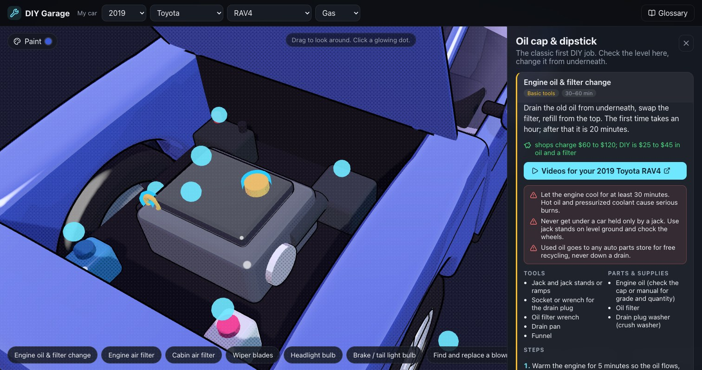
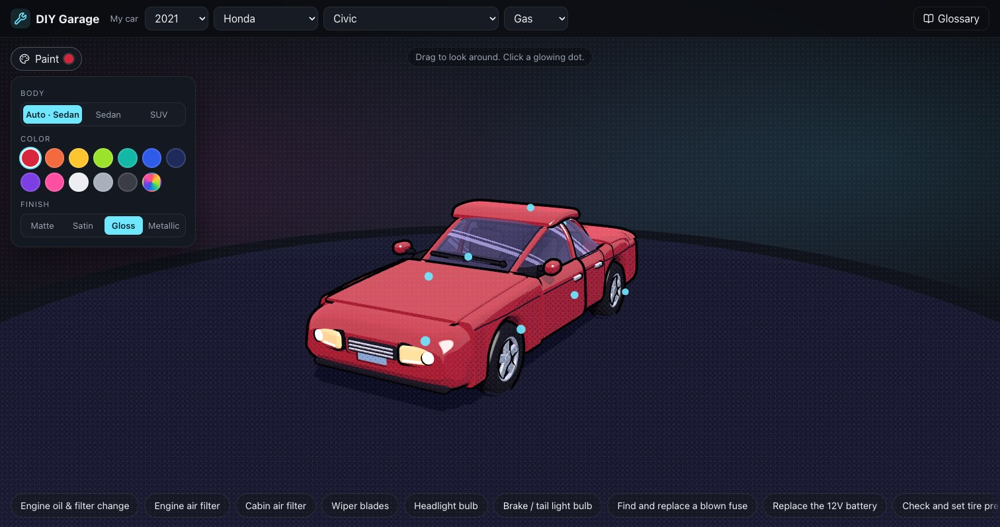

# DIY Garage

**Live site: https://sea-chels.github.io/diy-garage/**

Click a part of a stylized 3D car, see the repairs you can safely do yourself, and watch how-to videos for your exact year, make and model.

Purely client-side: Vite + TypeScript + Three.js, no backend, no database.


| Pick a part, get the job | Search everything you can fix |
|---|---|
|  |  |



## Run

```sh
pnpm install
pnpm dev        # http://localhost:5173
pnpm build      # outputs dist/
```

## Data sources

| What | Where | Cost |
|---|---|---|
| Models for a year + make | NHTSA vPIC API, keyless, CORS-enabled | Free |
| Repair catalog, steps, tools, cautions | `src/data/repairs.ts`, hand-written | Free |
| Videos | A YouTube search for your year, make, model and the job, opened in a new tab | Free |

## Project layout

```
src/
  data/parts.ts      clickable regions (PartId) and which lid hides them
  data/repairs.ts    the repair catalog; add jobs here
  data/makes.ts      make list, year range, powertrain guess
  api/vpic.ts        NHTSA model lookup
  api/youtube.ts     builds the YouTube search link
  scene/car.ts       the stylized car (swap this to iterate on the model)
  scene/scene.ts     renderer, lights, picking, camera fly-to
  scene/tween.ts     tiny tween runner
  ui/*               vehicle picker, side panel, glossary, icons
```

### Iterating on the car

`scene/car.ts` returns a `CarRig`. Anything that satisfies that interface works, including a GLB loaded with `GLTFLoader`. The rig must provide:

- a hotspot mesh list for every `PartId` in `data/parts.ts`
- a camera view per part plus an overview
- `setLid('hood' | 'trunk' | 'door', open)` for the opening animations

### Adding a repair

Add an entry to `REPAIRS` in `src/data/repairs.ts`. List the hotspots it belongs to in `parts`, add search words to `aliases`, and set `powertrains` if it does not apply to every car. Set `featured: true` to put it in the quick-fix bar.

## Deploy to GitHub Pages

1. Push to a GitHub repo on the `main` branch.
2. In the repo, go to Settings, then Pages, and set Source to "GitHub Actions".

The workflow in `.github/workflows/deploy.yml` builds with the right base path and publishes `dist/`.
